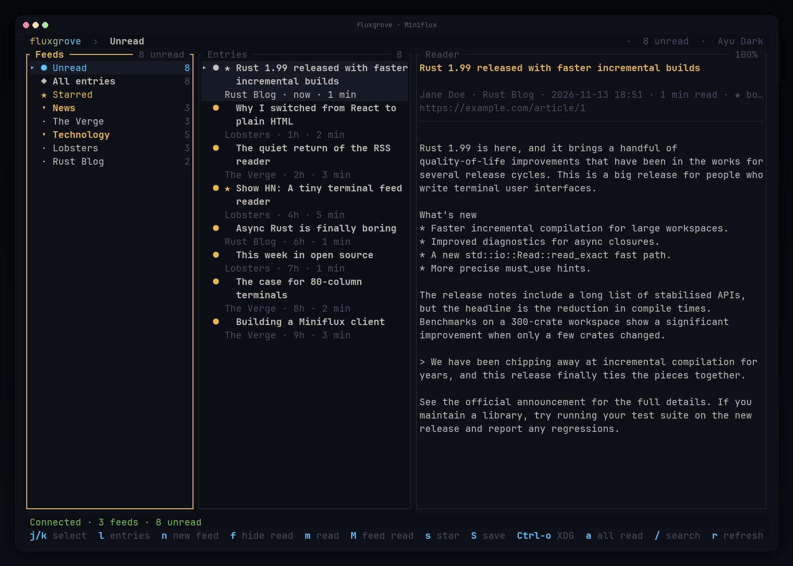
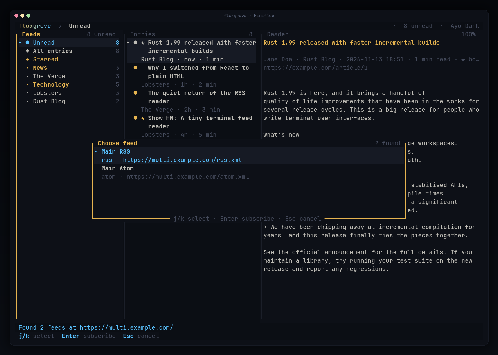

# fluxgrove

A vim-flavoured terminal client for [Miniflux](https://miniflux.app), built with
[Rust](https://www.rust-lang.org), [Ratatui](https://ratatui.rs) and
[opaline](https://github.com/hyperb1iss/opaline) themes.

fluxgrove gives you a three-pane reader: feeds on the left, entries in the middle,
and the article on the right. Everything is driven from the keyboard, with
familiar vim motions and a few reader-specific shortcuts.

## Screenshots

Screenshots use the **Ayu Dark** theme.



Feed discovery when subscribing with `n` — choose one when several feeds are found:



## Features

- Three-pane feed / entry / reader layout that adapts to narrow terminals.
- Starts on the Unread view, with Unread at the top of the feed panel.
- Vim motions: `j`/`k`, `h`/`l`, `g`/`G`, `Ctrl-d`/`Ctrl-u`, `Ctrl-f`/`Ctrl-b`.
- Entry list shows the article title plus feed / age / reading time.
- Long titles wrap to the available width instead of being clipped.
- Save articles to a configured Miniflux integration with `S`.
- Fetch and display the original article content with `F`.
- Hide feeds with no unread items, or read articles, with `f` depending on the
  focused panel; set both defaults in the config.
- Subscribe with `n` by entering a website URL; feeds are detected automatically
  and you can choose one when several are found.
- Server-side search, unread and starred views, per-category and per-feed views.
- Toggle read state and bookmarks, mark a whole view as read (with confirmation).
- Opening or stepping through articles with `J`/`K` marks them read automatically.
- Open the original article in your browser with `o`, or in the XDG default
  browser with `Ctrl-o`.
- HTML articles rendered as readable text, with word wrapping and scrollable reader.
- 39 built-in [opaline](https://crates.io/crates/opaline) themes with a live
  preview picker.
- Config file or environment variables; token or username/password authentication.
- Responsive: hides panes as the terminal gets narrower, down to a single pane.

## Installation

```sh
cargo install --path .
```

The resulting binary is `fluxgrove`.

## Configuration

Create `~/.config/fluxgrove/config.toml`:

```toml
url = "https://reader.example.com"
token = "your-api-token"

# Optional
theme = "catppuccin-mocha"
limit = 100             # entries fetched per view (1-500)
mark_read = true        # mark an entry read when you open it in the reader
hide_read_feeds = false  # hide feeds with no unread items by default
hide_read_entries = false # hide read articles in the entries panel by default
```

Generate an API token in Miniflux under **Settings → API Keys**.

You can also use username and password authentication:

```toml
url = "https://reader.example.com"
username = "demo"
password = "secret"
```

Environment variables override the config file:

```sh
MINIFLUX_URL=https://reader.example.com \
MINIFLUX_TOKEN=your-api-token \
fluxgrove
```

CLI flags take precedence over both:

```sh
fluxgrove --url https://reader.example.com --token "$MINIFLUX_TOKEN"
fluxgrove --config ./config.toml --theme tokyo-night
```

Run `fluxgrove --list-themes` to see the built-in theme ids. A theme chosen with
the in-app picker applies for the current session; set `theme` in the config to
make it stick.

## Keys

### Navigation

| Key | Action |
| --- | --- |
| `j` / `k` or `↓` / `↑` | Move in the focused pane, or scroll the reader |
| `h` / `l` or `←` / `→` | Focus the pane left / right (and open the entry) |
| `Tab` / `Shift-Tab` | Cycle panes |
| `1` / `2` / `3` | Focus feeds / entries / reader |
| `g` / `G` | Jump to top / bottom |
| `n` | Subscribe by website URL (feeds are detected automatically) |
| `f` in Feeds | Hide / show feeds without unread items |
| `f` in Entries | Hide / show read articles |
| `Ctrl-d` / `Ctrl-u` | Half page down / up |
| `PgUp` / `PgDn` | Page up / down |
| `Ctrl-f` / `Ctrl-b` | Full page down / up |
| `Enter` | Confirm: feeds → entries, entries → reader |
| `Esc` | Go back one pane |
| `q` | Quit |

### Reading

| Key | Action |
| --- | --- |
| `m` | Toggle read / unread (marks read, advances, and removes the entry when read articles are hidden) |
| `M` | Mark every entry in the current feed as read |
| `J` / `K` | Next / previous article while the reader is focused; marks it read |
| `s` | Toggle star / bookmark |
| `S` | Save the article to a configured Miniflux integration |
| `F` | Fetch and display the original article content |
| `a` | Mark everything in the current view as read (asks for confirmation) |
| `o` | Open the original article in the preferred browser |
| `Ctrl-o` | Open the original article in the XDG-defined browser |
| `r` | Ask Miniflux to refresh feeds |

### Search and appearance

| Key | Action |
| --- | --- |
| `/` | Search entries (Miniflux full-text search) |
| `c` | Clear the active search |
| `t` | Open the theme picker (`j`/`k` preview, `Enter` apply, `Esc` cancel) |
| `?` | Toggle the help overlay |
| `Ctrl-C` | Quit from any mode |

## Notes

- Feed discovery uses Miniflux, like the web interface. Enter a website URL and
  fluxgrove asks Miniflux to find its feeds; if several are found, a picker is
  shown. The new feed is added to the currently selected category or the
  category of the selected feed. Otherwise the first category is used.
- Miniflux must have the API enabled; API keys are created in the web UI.
- The reader shows the content stored by Miniflux. Press `o` to open the
  original article in your browser.
- The UI is designed for truecolor terminals, but degrades gracefully.

## How it works

- [Ratatui](https://ratatui.rs) renders the interface.
- [opaline](https://crates.io/crates/opaline) supplies the token-based theme
  engine and all built-in themes. Semantic tokens such as `bg.panel`,
  `text.muted` and `accent.primary` are used throughout rather than hard-coded
  colors.
- [`miniflux_api`](https://crates.io/crates/miniflux_api) talks to the Miniflux
  REST API from a single background worker, so the UI never blocks on HTTP.
- Article HTML is converted to text by `html2text` and re-wrapped to the reader
  pane width, so resizing the terminal reflows the article.

## Development

```sh
cargo test
cargo clippy --all-targets -- -D warnings
cargo fmt --check
```

## License

Copyright (C) 2026 the fluxgrove authors.

fluxgrove is licensed under the GNU General Public License, version 3 only
(`GPL-3.0-only`). See [LICENSE](LICENSE) for the full license text.

The `miniflux_api` dependency is `GPL-3.0-or-later`, which is compatible with
using the combined work under GPLv3.
